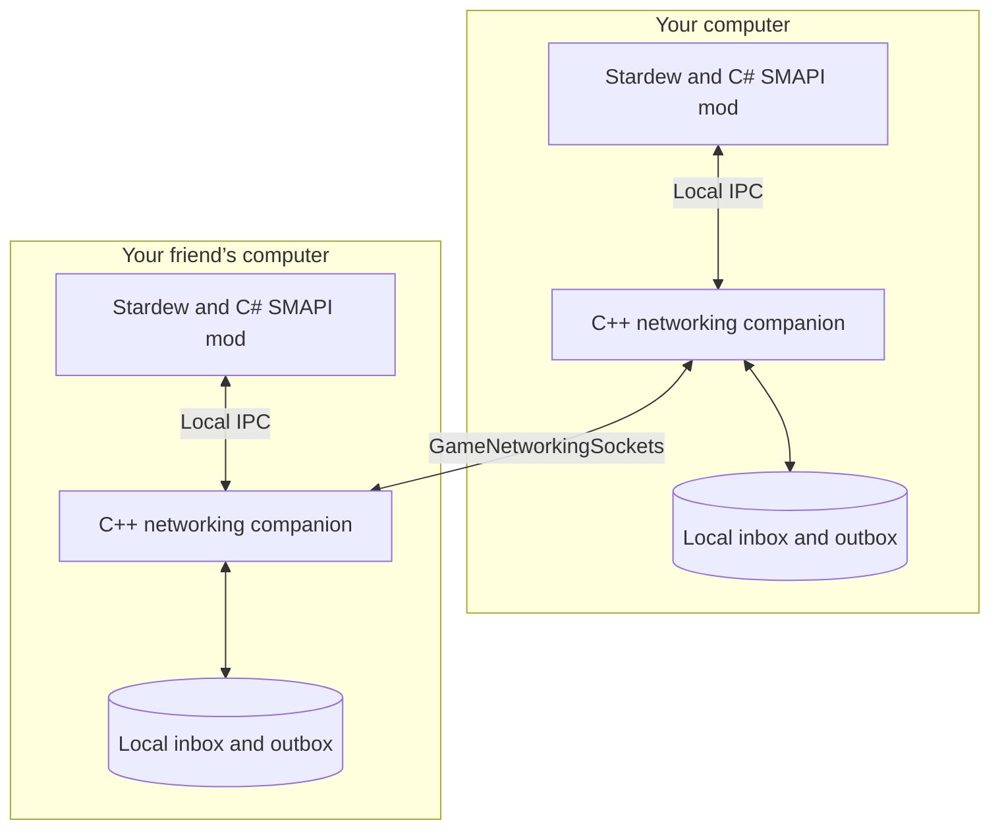
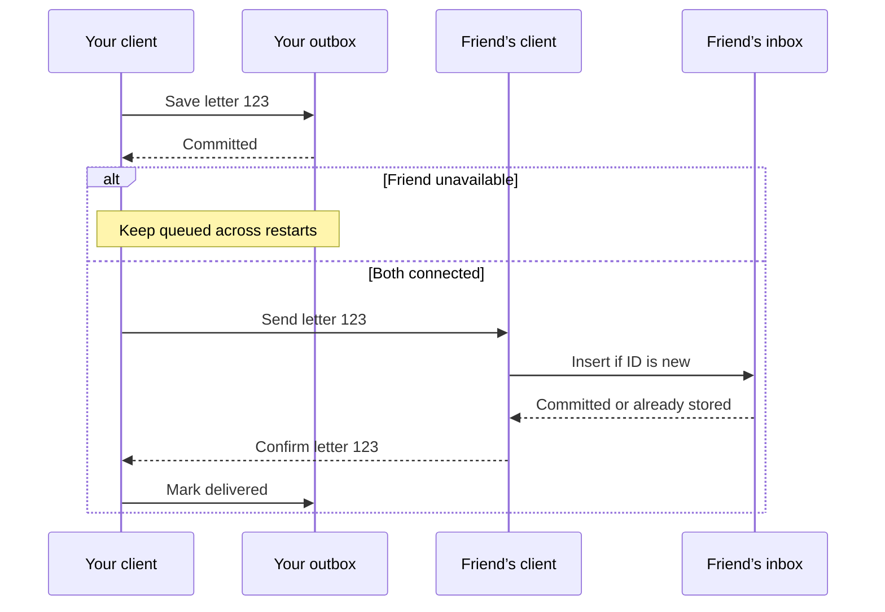
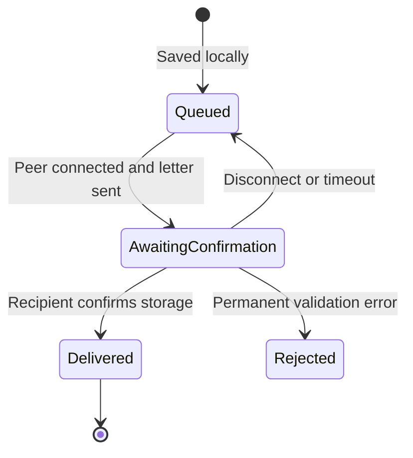

# Stardew Birthday Expansion

Add friends from other single-player farms, remember their birthdays, and send gifts with personal notes through the mailbox.

Mail waits in your local outbox until you and your friend are connected. Once delivered, your friend can open it later.

**Status - initial design.** C++ networking with Valve GameNetworkingSockets and C# game integration through SMAPI.

## How it connects

Proposed architecture - each player runs a SMAPI mod and a small C++ companion process. Each companion owns its local mail database.



Start with a direct address connection on localhost or LAN. Internet delivery needs a decision on peer authentication, signaling, and NAT traversal. Valve documents those requirements in its [P2P guide](https://github.com/ValveSoftware/GameNetworkingSockets/blob/master/README_P2P.md).

## Sending a letter

Each letter has a unique ID. A delivery confirmation means the recipient saved it locally.



## Disconnects and retries



| Case | Behavior |
| --- | --- |
| Friend offline | Letter stays queued on your computer |
| You close the game | Queue reloads next time you launch |
| Friend comes online while you are offline | Delivery waits until both clients connect |
| Confirmation gets lost | Resend the same ID; recipient confirms the existing letter |
| Recipient storage fails | Keep the letter queued until storage succeeds |
| Letter already delivered | Friend can read their local copy anytime |

**Idempotency:** receiving letter 123 repeatedly creates one inbox entry. Save the inbox entry before confirming delivery. Retry with the original ID and content.

## Birthdays

Players choose a month and day. Map March–May to Spring, June–August to Summer, September–November to Fall, and December–February to Winter. Compress each season into 28 days.

`day = floor(days_since_season_start × 28 / days_in_season) + 1`

June 1 becomes **Summer 1**. Use a fixed reference calendar so the mapping stays stable. Reminder timing, timezone, and February 29 behavior are open decisions.

## First playable milestone

- [ ] Two C++ clients exchange text letters through GameNetworkingSockets.
- [ ] Local inbox and outbox survive restarts.
- [ ] Lost confirmations and retries produce one inbox entry.
- [ ] SMAPI provides compose and mailbox screens.
- [ ] Profiles display a chosen birthday and its Stardew equivalent.

**Next - gift attachments.** Coordinate item removal and claiming with Stardew saves so crashes and day rollbacks can be reconciled. Text delivery and item ownership need separate state tracking.

## Design review

- C++ companion process or native DLL loaded by SMAPI?
- Cross Platform Considerations
- Friend identity per player or per farm?
- Birthday reminders on real dates or farm dates?
- How do friends pair and connect across the internet?
- How should gifts behave after restoring an older save?

## C++ networking setup

The smoke executable initializes and shuts down Valve's GameNetworkingSockets. For
direct localhost work, the build disables native ICE and WebRTC, and skips Valve's
example signaling server. The library still exposes its custom P2P signaling API.
CMake links Valve's static target from the pinned submodule. The vcpkg manifest
uses Valve's registry baseline for OpenSSL, protobuf with its matching
`protoc` compiler, and spdlog. See [Valve's build guide](https://github.com/ValveSoftware/GameNetworkingSockets/blob/d534c19aa760df3fb75fd20db13ba1932b8a5463/BUILDING.md).

Install Git and CMake 3.25 or newer. The optional presets also require Ninja.
On macOS, install Xcode Command Line Tools (`xcode-select --install` if needed)
and use a native terminal for your Mac's architecture. On Windows, install
Visual Studio 2022 or its Build Tools with
Desktop development with C++ and the Windows SDK, then use an **x64 Native Tools
Command Prompt** with CMake on `PATH`.

From the directory where you want the checkout:

```sh
git clone --recurse-submodules git@github.com:ryan-mangeno/stardew-bday.git "stardew bday"
cd "stardew bday"
git submodule update --init --recursive
```

The recursive update also works on an existing checkout. It fetches Valve's
optional nested dependencies, including WebRTC. If an optional remote is
unavailable, this scaffold only needs `git submodule update --init -- external/GameNetworkingSockets`.

Bootstrap vcpkg once in a directory with a short absolute path that contains no
spaces. vcpkg builds third-party packages there. Run these commands in your checkout:

```sh
# macOS
export VCPKG_ROOT="$HOME/vcpkg-stardew"
git init "$VCPKG_ROOT"
git -C "$VCPKG_ROOT" fetch --depth 1 https://github.com/microsoft/vcpkg.git 522253caf47268c1724f486a035e927a42a90092
git -C "$VCPKG_ROOT" checkout --detach FETCH_HEAD
"$VCPKG_ROOT/bootstrap-vcpkg.sh" -disableMetrics
cmake -B build
cmake --build build
"./build/stardew_bday_networking"
```

```bat
:: Windows x64 Native Tools Command Prompt
set "VCPKG_ROOT=C:\vcpkg-stardew"
git init "%VCPKG_ROOT%"
git -C "%VCPKG_ROOT%" fetch --depth 1 https://github.com/microsoft/vcpkg.git 522253caf47268c1724f486a035e927a42a90092
git -C "%VCPKG_ROOT%" checkout --detach FETCH_HEAD
call "%VCPKG_ROOT%\bootstrap-vcpkg.bat" -disableMetrics
cmake -B build
cmake --build build
".\build\stardew_bday_networking.exe"
```

Set `VCPKG_ROOT` again in a new shell. CMake installs the manifest dependencies
on the first configure. CMake selects the vcpkg triplet for Windows x64 or the
native macOS architecture. Quote the path when changing into a checkout that
contains spaces. Run the same build commands from there.

For a Ninja Release build, use `cmake --preset <name>` and
`cmake --build --preset <name>` with `windows`, `macos-arm64`, or `macos-x64`.
The executable then appears under `build/<name>/`.
